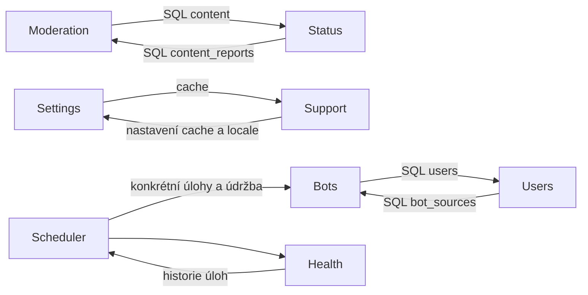

# TinyCat 6.0.0 — audit modularity a návrh přechodu

Datum: 1. 11. 2026. Stav: návrh pro rozhodnutí před implementací 6.0.0.

Audit pokrývá aktuální pracovní strom 5.16.1, včetně rozpracované moderace a
nového stavu příspěvků. Nehodnotí pouze poslední commit. Výchozí Git HEAD je
`dccaa09a54f415ec1cdacb65fa3c7b4b36751870`; fingerprint analyzovaných PHP zdrojů,
vlastnictví tabulek a naměřené vazby jsou v
[inventáři](modularity-6.0.0-inventory.json).

V tomto kroku se nemění runtime, databáze, instalace ani číslo verze.

## 1. Závěr

TinyCat má funkční základ modulárního monolitu, ale hranice modulů dnes nejsou
úplným kontraktem. Vlastnictví rout a názvy tabulek jsou rozdělené; instalace,
seedování, části údržby, integrační zápisy a některé prezentační konfigurace
zůstávají centralizované nebo zasahují do interních dat jiné domény.

Přesun `CREATE TABLE` z instalátoru do několika souborů by vyřešil jen jednu
část problému. Pro 6.0.0 je potřeba společně upravit vlastnictví schématu,
veřejná rozhraní modulů, skládání aplikace a pravidla, která tyto hranice hlídají.

Doporučený cíl: **jedna aplikace, jedna databáze a jedno nasazení; moduly s
explicitními závislostmi a vlastním schématem, use cases a veřejným rozhraním**.
K tomu není nutný nový framework, microservices ani obnovení systému pluginů.

## 2. Co už funguje a má zůstat

- [App/modules.php](../App/modules.php) obsahuje explicitní seznam modulů.
  [bootstrap](../App/bootstrap.php#L23) skládá jejich registrace místo jednoho
  seznamu všech aplikačních rout v transportní vrstvě.
- Moduly vlastní `Api`, `Pages` a většinu prezentačních zdrojů. Sdílený transport
  `Http/Api`, JSON envelope, validace a CSRF jsou vhodné stavební kameny.
- `StorageModule::tables()` už dává tabulkám deklarovaného vlastníka.
- `Status/PostCreation` představuje jednu sdílenou cestu vzniku příspěvku, kterou
  využívá i import. Tento invariant se nemá při modularizaci ztratit.
- PHP a klient sdílejí definice komponent; existují modulové manifesty assetů,
  jednotné modaly, formuláře a řízení jejich životního cyklu.
- Testy pokrývají chování, SQL limity, MySQL, podepsané balíčky, instalaci,
  aktualizaci a rollback. Tyto záruky jsou důležitější než kosmetické rozdělení
  souborů nebo nový počet rozhraní.

## 3. Inventura a význam čísel

| Ukazatel | Zjištěný stav |
| --- | --- |
| Registrované backendové moduly | 13 |
| PHP soubory pod `App/` | 236 |
| Tabulky vytvářené instalátorem | 22 |
| Tabulky deklarované přes `StorageModule` | 21, každá právě jedním modulem |
| Systémová tabulka mimo tyto deklarace | `schema_migrations` |
| Migrační soubory v kořenovém `migrations/` | 26 |
| Unikátní reference PHP soubor → cizí třída/namespace | 964 |
| Dvojice soubor/cizí tabulka s rozpoznaným zápisem | 13 |

`schema_migrations` je legitimní systémová tabulka; rozdíl 22/21 sám o sobě
není důkaz chybějící business tabulky. Potřebuje však explicitního systémového
vlastníka v novém katalogu schémat.

Zápisy jsou detekované nad doslovnými SQL názvy a `Connection::insert/update/delete`.
Číslo 13 neznamená počet všech SQL příkazů: více zápisů do stejné tabulky v jednom
souboru tvoří jednu dvojici. Dynamické SQL, vlastnictví sloupců a FK kaskády se
musí posuzovat ručně. Čtení cizí tabulky není automaticky architektonická chyba.

Graf agregovaných namespace obsahuje jednu silně souvislou skupinu 16 oblastí:
`Bots`, `Database`, `Health`, `Http`, `Mail`, `Moderation`, `Notifications`,
`Scheduler`, `Search`, `Security`, `Settings`, `Site`, `Status`, `Support`,
`Updates`, `Users`. To dokládá strukturální propojení balíků, nikoliv nekonečnou
rekurzi za běhu. Široké balíky `Support` a `Http` navíc agregují různé role.

## 4. Konkrétní nálezy

Priority zde vyjadřují pořadí architektonické práce pro 6.0.0, nikoliv seznam
aktuálních bezpečnostních zranitelností.

| ID | Priorita | Doložený problém | Co je potřeba změnit |
| --- | --- | --- | --- |
| M01 | P1 | [Installer::create_tables](../App/Installation/Installer.php#L97) obsahuje DDL všech 22 tabulek; [default_settings](../App/Installation/Installer.php#L441) zná nastavení jiných domén a `create_admin_account` přímo vytváří uživatele. `StorageModule` deklaruje pouze názvy. | Modul vlastní aktuální schéma a svoje výchozí hodnoty. Instalace koordinuje poskytovatele schématu a volá bootstrap účtu přes Users. |
| M02 | P1 | [Module](../App/Module.php) a [StorageModule](../App/StorageModule.php) jsou jediné PHP interfaces. Kontrakt neobsahuje stabilní ID, závislosti, exportované služby ani instalační schopnosti. | Zavést lehký katalog modulů a oddělené schopnosti poskytovatelů. Veřejné doménové kontrakty odlišit od interních tříd. |
| M03 | P1 | [Moderation/Reports](../App/Moderation/Reports.php#L19) zapisuje do `content`; [Status/Actions](../App/Status/Actions.php#L281) vytváří `content_reports`; [Status/Posts](../App/Status/Posts.php#L232) je při mazání odstraňuje. | Reportování vlastní Moderation; změnu viditelnosti provádí veřejná operace Status. Společný use case zachová transakci a pořadí zámků. |
| M04 | P1 | [Bots/Actions](../App/Bots/Actions.php#L23) vytváří řádek `users`, zatímco [Users/Accounts](../App/Users/Accounts.php#L18) vypíná `bot_sources`. Smazání účtu navíc zná tabulky a soubory Status. | Účty vytváří Users; změnu účtu koordinuje aplikační workflow s přispěním Bots a Status. Vlastník dat poskytne potřebnou operaci. |
| M05 | P1 | [Scheduler/Tasks](../App/Scheduler/Tasks.php#L11) zná konkrétní `feeds`, `cleanup`, `site-health` i validaci jejich parametrů. [Cleanup](../App/Scheduler/Cleanup.php#L24) obsahuje seznam cizích údržbových operací a jejich SQL. [Health/Checks](../App/Health/Checks.php#L69) zná `bot_sources` a názvy úloh. | Scheduler vlastní běh, zámky, plán a historii; moduly poskytují úlohy, validátory, retenci a health sondy. |
| M06 | P1 | [Cache](../App/Support/Cache.php#L676) a [Localization](../App/Support/Localization.php#L35) čtou `Settings/Store`; Store sám používá cache. Bootstrap používá tuto fasádu už před registrací modulů. | Oddělit čistou konfiguraci před DB od aplikačních nastavení. Cache a překladač dostanou konfiguraci explicitně při skládání. Allowlist a guardy dnes tlumí runtime cyklus; samotné volání z bootstrapu neprokazuje načtení nastavení z DB. |
| M07 | P1 | [Moderation/Reports](../App/Moderation/Reports.php#L30) řeší HTTP chyby, aktuální autentizaci, transakci a cizí zápisy v jednom místě. [Delivery::create](../App/Notifications/Delivery.php#L89) může odeslat e-mail ještě uvnitř transakce volajícího. | HTTP a session ponechat v adaptéru. Use case přijme aktéra a vstup explicitně, vrátí výsledek/typovanou chybu. Externí efekty provádět po commitu, případně přes outbox. |
| M08 | P2 | [Site/Navigation](../App/Site/Navigation.php#L10) zná konkrétní moduly; [Support/AdminSorting](../App/Support/AdminSorting.php#L10) vlastní jejich SQL aliasy, endpointy a cíle. [Settings/Store](../App/Settings/Store.php#L205) obsahuje globální seznam doménových klíčů. | Navigaci, definice řazení, nastavení a jejich citlivost přispívá vlastník. Sdílené služby je jen validují a skládají. |
| M09 | P2 | Backend používá explicitní `App/modules.php`, ale [assety](../App/Support/ClientAssets.php#L91), [komponenty](../App/Support/Components.php#L19) a [překlady](../App/Support/TranslationSources.php#L32) hledají jiné adresáře přes glob. [Bots/views](../assets/modules/bots/views.js#L79) spoléhá na `T.status.modal`, aniž by tím deklaroval veřejný frontendový kontrakt. | Jeden katalog vybere backend i příslušné assety a katalogy. Deklarovat závislosti a veřejná klientská API, zachovat existující build a lifecycle. |
| M10 | P1 | [Updater](../App/Updates/Manager.php#L407) přijímá migrace pouze z `migrations/`; [builder](../tools/build-update.php#L182) tento předpoklad sdílí. Přesun migrací do modulů není izolovaná změna složek. | Modulové vlastnictví oddělit od distribučního formátu. Zachovat historická ID/checksumy a připravit kompatibilní přechod z 5.x. |
| M11 | P1 | [Test hranic](../tests/quality/module-boundaries.php) a [test závislostí](../tests/quality/dependencies.php) procházejí, ale nevyžadují acyklický kontrakt modulů, nehlídají obecně cizí DML, vlastnictví sloupců ani deklarované závislosti. | Architektonická pravidla převést do pozitivních i negativních testů dříve, než začne větší přesouvání. |

Ani vysoký fan-out Site/Search, ani SQL JOIN přes více vlastníků není sám o sobě
chyba. Problém je nepojmenovaný kontrakt a možnost měnit interní data jiného
modulu bez jeho pravidel. Read modely a agregace potřebují jiné pravidlo než zápisy.

Zjednodušená ukázka dnešních vazeb:

Šipka znamená znalost či zásah do dat druhé oblasti; nemusí jít o volání jejího API.

## 5. Cílové hranice pro 6.0.0

### Modul

Modul vlastní svoje schéma, migrace, výchozí hodnoty a business operace.
Zveřejňuje malou explicitní sadu příkazů a dotazů; ostatní třídy jsou interní.
Samotné PHP namespace toto soukromí nevynutí — musí ho vynucovat testy.

Katalog používá stabilní ID, například `users`, `status`, `moderation`, a odděluje
jej od názvu PHP třídy a fyzického umístění souboru. Deklaruje skutečné závislosti
na kontraktech, nikoliv libovolné přístupy do cizích namespace.

Není potřeba, aby každý modul implementoval osm prázdných metod. Vhodnější je
malý popis modulu a volitelní poskytovatelé: schéma, migrace, routy, nastavení,
úlohy, navigace, assety/překlady a health kontroly. Poskytovatel nemá při pouhém
načtení definice provádět SQL, HTTP, zápisy do souborů ani číst session.

### Skládání aplikace a platforma

Composition root smí znát všechny vybrané moduly — právě to je jeho práce.
Má je zapojovat, validovat chybějící závislosti, duplicity a pořadí inicializace;
nemá přebírat jejich SQL nebo rozhodovací pravidla. Katalog se nesmí stát novým
`Core` s příkazy typu „pokud Bots, proveď tuto konkrétní operaci“.

Platforma poskytuje transport, DB/transakce, storage, cache, hodiny a základní
validaci. Nečte přímo doménové nastavení a nezná post provider nebo konkrétní
scheduler token. Dnes například `Http/Web` volá `Status/Providers` a middleware
zná `Scheduler/Tokens`; takové politiky mají přijít registrací/adaptérem.

Podstatné vstupy služeb, například aktér a konfigurace, mají být explicitní.
Není nutné mechanicky převést každý helper ze statické metody ani zavést
obecný service locator či externí DI kontejner. Začít je vhodné u skutečných
hranic a služeb, které dnes skrývají session, DB a boční efekty.

### Vlastnictví dat a společné transakce

Výchozí pravidlo: modul zapisuje do svých tabulek; jiná doména používá jeho
veřejnou operaci. Například Moderation vyhodnotí report, ale o změnu viditelnosti
požádá Status, nikoliv `Connection::update('content', ...)`.

Jedna databáze dovoluje, aby tyto operace zůstaly v jedné transakci. Skrytí
příspěvku, vyřízení reportů a omezení účtu se nesmí rozpadnout do nezávislých
asynchronních událostí. Pořadí zámků a opakování příkazů je součást kontraktu.

Pro e-mail, soubory a další nevratné efekty je vhodná fáze po commitu; kde je
požadavek na spolehlivé doručení a opakování, použít transakční outbox.
Nezavádět událostní sběrnici pro každé obyčejné volání metody.

FK kaskády mezi moduly mohou zůstat, pokud jsou výslovnou součástí integračního
kontraktu. Samy neřeší mazání souborů, cache a dalších vazeb. Smazání účtu proto
potřebuje koordinovaný plán účastníků, ne Users s ručně udržovaným seznamem
všech tabulek a médií ostatních modulů.

Zvlášť je nutné rozhodnout vlastnictví polí, například `users.muted_*`.
Pouhé přesunutí SQL do libovolného repository cyklus vlastnictví nevyřeší.
Rozumný první krok je Users jako vlastník stavu účtu a Moderation jako vlastník
pravidla omezení, komunikující přes explicitní kontrakt. Rozdělení tabulky je
další datové rozhodnutí, nikoliv automatický požadavek modularity.

### Čtení a výkon

Site dashboard a Search mohou potřebovat údaje více modulů. Použít hromadné
čtecí kontrakty nebo vyhrazené read modely s explicitně povolenými závislostmi.
Dobře zdůvodněné read-only JOINy lze zachovat; nenahrazovat je N+1 voláními,
interním HTTP nebo globálním repository pro libovolnou tabulku.

Viditelnost příspěvků má mít jednoho vlastníka. Dnešní opakované SQL podmínky
ve Status, Search, Site, Users a Notifications jsou příkladem čtecího kontraktu,
který je nutné pojmenovat a testovat. Výběr ID před načítáním detailů, přesné
počty, pořadí a filtry před limitem zůstávají závazné podle
[standardu dotazů](query-selection-standard.md).

### Frontend

Zachovat komponenty, společné UI služby a jejich `hydrate`/`dispose`. Doplnit
deklarované závislosti a veřejná API pro editor/náhled Status namísto implicitní
dohody „nějaký jiný manifest už načetl `T.status`“.

Backendový výběr modulů a build assetů mají vycházet ze stejného katalogu.
Fyzické JSON/CSS/JS soubory mohou zatím zůstat tam, kde jsou. Samotný glob může
sloužit ke čtení zdrojů uvnitř zvoleného modulu, nemá nezávisle rozhodovat o
tom, které funkce aplikace jsou zapojené.

Dosavadní bundler importy řadí a skládá do společných skriptů; skutečné ESM
exporty nelze přidat bez úpravy tohoto kontraktu. Modularita není důvod sama o
sobě zavádět Vite/Node build ani měnit limit čtyř skriptů a jednoho stylesheetu.

## 6. Jak má vypadat instalace

1. Načíst čistou základní konfiguraci a explicitní katalog modulů bez DB/session.
2. Ověřit závislosti, jedinečné vlastníky schématu a spočítat instalační pořadí.
3. Založit systémové schéma platformy včetně evidence migrací.
4. Vyvolat aktuální schéma každého vybraného modulu; například Users před Status
   a obě domény před integračními FK Moderation/Bots.
5. Zaregistrovat výchozí hodnoty jejich vlastníky a vytvořit první účet přes
   instalační kontrakt Users.
6. Zapsat konzistentní stav migrací a ověřit připravenost deklarovaných schémat.

Instalační UI pouze vede uživatele a prezentuje obecný výsledek. Překlady popisu
tabulek nemusí odvozovat z globální konvence `install.purpose_<table>`;
metadata svého schématu poskytne vlastník.

Aktuální schéma pro fresh install a historické upgrady jsou různé artefakty
téhož vlastníka. Jejich rovnost se má automaticky porovnávat na normalizovaných
sloupcích, indexech, FK a výchozích hodnotách, ne udržovat ručně bez kontroly.

## 7. Doporučené pořadí práce

| Etapa | Obsah | Podmínka dokončení |
| --- | --- | --- |
| 0 — výchozí stav | Oddělit a zaznamenat rozpracované změny 5.16.x, vlastnictví a veřejné integrační scénáře. | Reprodukovatelný baseline pro chování, schéma, API, assety a výkon; žádný ztracený rozpracovaný stav. |
| 1 — pravidla a katalog | ADR k hranicím, lehká definice modulů, stabilní ID, závislosti a systémové poskytovatele. | Duplicitní ID/tabulka, chybějící závislost a nepovolený cyklus mají negativní test, který skutečně selže. |
| 2 — start a instalace | Oddělení platformy/config/cache; modulová schémata a seedy; tenký instalátor. | Načtení katalogu a registrací před kontrolou DB nedělá doménové SQL; fresh install a upgrade vedou ke stejnému schématu. |
| 3 — svislý pilot Moderation | Moderation vlastní reportování; Status vlastní viditelnost; Users omezení účtu; explicitní notifikace. | Žádné vzájemné přímé DML, zachované společné transakce a všechna nová pravidla reportování/hidden. |
| 4 — další integrace | Users ↔ Bots, smazání účtu/příspěvku, registry scheduleru, retence, health, nastavení a navigace. | Přidání úlohy nebo doménového nastavení nevyžaduje editaci centrálního seznamu cizích funkcí. |
| 5 — čtení a frontend | Pojmenované čtecí kontrakty/projekce, veřejná klientská API a assety z katalogu. | Žádné implicitní závislosti mezi klientskými moduly; bez růstu N+1 a bez úniku skrytého obsahu. |
| 6 — vydání 6.0.0 | Kompatibilní migrační exporty, podpisy, instalační a update/rollback matice. | Prokázaný upgrade podporované 5.x, přerušení/opakování, rollback a fresh install; teprve potom změna verze a vydání. |

Změny provádět po svislých funkčních řezech s dočasnými úzkými adaptéry.
Nejdřív přestěhovat veškeré soubory a až potom opravovat chování by vytvořilo
velký obtížně kontrolovatelný diff a riziko pro updater.

`requires` nelze vygenerovat slepě ze současného grafu importů: ten už cykly
obsahuje. Nový graf kontraktů a instalačních závislostí musí mít vlastní návrh.
Dočasné legacy adaptéry potřebují konkrétní, zmenšující se seznam povolených
výjimek; nový kód nesmí přidávat další cizí zápisy nebo interní importy. Tak lze
nová pravidla zapnout postupně bez předstírání, že je celý starý strom již splňuje.

## 8. Přechod migrací z 5.x

Stávající updater kontroluje cesty `migrations/*.php`, hash souboru a ID odvozené
z názvu. Historické soubory se proto nesmí přejmenovat ani upravit jen proto,
aby odpovídaly nové struktuře. Jejich aplikované checksumy zůstávají platné.

Preferovaný kompatibilní postup pro první 6.0.0: nový modul vlastní zdroj a
metadata své migrace, ale builder ji exportuje jako podepsaný artefakt do
dosavadního kořenového `migrations/` s globálně jednoznačným ID. Migrační callback
musí umět pracovat s předaným PDO bez spuštění nového aplikačního kernelu.
Výsledný soubor a checksum musí být stabilní a jeho umístění nesmí změnit chování
relativních cest. To vyžaduje samostatný test builderu a starého updateru.
Export je generovaný distribuční artefakt, nikoliv druhý ručně udržovaný zdroj
migrace. Fresh-install balíček musí nové modulové migrační zdroje posuzovat podle
katalogu; pouhé dnešní vyloučení kořenové složky `migrations/` už nebude stačit.

Alternativou je samostatná přechodová verze updateru. Volbu provést před
stěhováním souborů; neposlat přímý update s modulovými cestami, které instalovaný
5.x updater odmítne. Minimální podporovanou 5.x verzi nelze změnit jen z pohodlí
refaktoru bez popsané aktualizační cesty.

## 9. Co musí vynucovat testy 6.0.0

- Katalog modulů: stabilní ID, závislosti a exporty; odhalení duplicit a
  nepovolených cyklů. Orchestrace smí záviset na více kontraktech, ale nesmí tím
  vzniknout skrytý cyklus implementací.
- Platforma nesmí importovat konkrétní business modul. Sdílené doménové hodnoty
  musí mít úzké, pojmenované místo; `Support` nesmí být výjimkou pro všechno.
- Zápisy do cizích tabulek mimo vlastníka selžou. Dynamické SQL má dohledatelné
  repository vlastníka; existují negativní fixtures pro plně kvalifikovaná
  volání i SQL text, nejen kontrola názvů souborů.
- Cross-module import je povolen pouze do veřejného kontraktu nebo do výslovně
  deklarované čtecí integrace. HTTP, session, překlad a přesměrování nepatří do
  business operace.
- Přidání testovacího modulu se schématem a úlohou funguje bez změny Instalace,
  Scheduleru a centrální navigace. Tato fixture netvrdí, že Users lze z reálného
  produktu libovolně vypnout.
- Fresh schema = podporovaný upgrade; zachování dat, reportů a médií, správné
  FK, ID a checksumy. Selhání před/po commitu nevyvolá předčasný e-mail ani
  nevratný úklid souboru.
- Zachovat API a frontendové kontrakty, přístupová práva, query budgets,
  limity assetů a chování při přerušení instalace/aktualizace.

V tomto auditu znovu prošly existující kontroly
`php tests/quality/module-boundaries.php` (806 kontrol) a
`php tests/quality/dependencies.php` (1 132 evidovaných hran). Jejich zelený
výsledek není potvrzením výše navržených nových pravidel — právě ta zatím
nepokrývají. Celý preflight nebyl znovu spouštěn; nevznikla runtime změna.

## 10. Rozhodnutí před první implementační etapou

1. Potvrdit cíl modulárního monolitu a které moduly tvoří povinný produktový
   základ. Možnost vypínat moduly ani pluginový obchod nejsou automatickou
   součástí tohoto návrhu.
2. Potvrdit vlastnictví účtu/omezení, příspěvku/viditelnosti, reportování a
   mazacích workflow. Pojmenovat malá veřejná rozhraní na skutečných integracích.
3. Vybrat distribuční kompatibilitu migrací pro 5.x → 6.0.0 a zachovat podpisy,
   checksumy, zálohy a rollback.
4. Implementovat etapu 1 a pilotní scénář, vyhodnotit dopad na počet dotazů a
   složitost, teprve pak pokračovat s dalšími moduly.

Začít doporučuji katalogem, vlastnictvím schématu a testy instalace. Úspěch
6.0.0 se má poznat podle toho, že změna jedné domény nemusí upravovat centrální
instalátor, scheduler a několik cizích zapisovačů — ne podle přesunutých složek.
