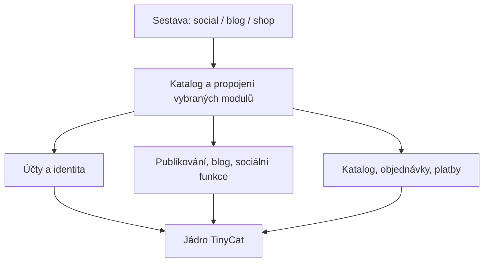

# TinyCat jako modulární platforma

Stav: cílový návrh, 11. 11. 2026. Výchozí implementace: 5.22.2,
commit `ddc5768`. Rozhraní, adresáře a nové názvy modulů níže popisují cílovou
strukturu, nikoli již dokončenou přestavbu aplikace.

Průběh zavádění a skutečně implementovaný rozsah eviduje
[implementační plán](modular-platform-implementation.md). Návrh jako celek
zůstává cílovým stavem; první katalog neznamená hotovou modulární platformu.

TinyCat má poskytovat technické jádro, nad kterým se sestaví sociální web,
blog, obchod nebo jiná aplikace. Typ produktu určuje explicitní výběr modulů
a jejich propojení. Jádro nevyžaduje příspěvky, veřejné profily ani sociální feed.
Zůstává jedna aplikace, jedna databáze a jedno nasazení.

## Co v současném konceptu chybí

[Původní audit](modularity-6.0.0.md) dobře popisuje vlastnictví dat,
transakce a přechod migrací. Jeho výchozím produktem je ale sociální TinyCat;
nevymezuje dostatečně minimum aplikace bez sociálních funkcí ani přesný
způsob registrace všech příspěvků modulu.

Ověřené překážky v aktuálním kódu:

| Místo | Současný stav | Potřebná hranice |
| --- | --- | --- |
| [Seznam modulů](../../App/modules.php), [bootstrap](../../App/bootstrap.php) | Explicitních 13 modulů; rozhraní umí registraci rout a případně názvy tabulek. Bootstrap přímo vybírá Users pro autentizaci a připravenost instalace. | Jeden katalog celé sestavy a předané kontrakty identity a připravenosti. |
| [Status](../../App/Status/Module.php) | Registruje `/`, příspěvky i tagy. | Úvodní stránku vybírá sestava; publikování není povinné. |
| [Users](../../App/Users/Module.php), [role](../../App/Users/Roles.php) | Účty zahrnují sledování, autorské feedy, sociální vlastnosti rolí a vazby na Status. | Oddělit identitu od sociálního profilu a vztahů. |
| [Instalátor](../../App/Installation/Installer.php) | Obsahuje DDL, nastavení domén a vytvoření účtu. | Modul vlastní schéma a výchozí hodnoty; instalátor koordinuje. |
| [Úlohy](../../App/Scheduler/Tasks.php), [úklid](../../App/Scheduler/Cleanup.php) | Scheduler zná konkrétní Bots/Health úlohy, jejich parametry a cizí údržbu. | Jádro spouští registrované úlohy; obsah a validaci dodává vlastník. |
| [ClientAssets](../../App/Support/ClientAssets.php), [Components](../../App/Support/Components.php), [TranslationSources](../../App/Support/TranslationSources.php) | Nezávislé globy vybírají frontend a překlady z adresářů. | Zdrojové cesty poskytne stejný katalog jako backendu. |
| [Navigace](../../App/Site/Navigation.php), [sitemap](../../App/Site/Sitemap.php), [HTTP hlavičky](../../App/Http/Web.php) | Znalost konkrétních domén, SQL obsahu nebo Status providerů. | Registrace navigace, veřejných URL a omezených CSP příspěvků. |
| [Notifikace](../../App/Notifications/Delivery.php) | Doručování používá přímo content/comment ID a logiku zmínek Status. | Obecná schránka oddělená od sociálních producentů a cílových odkazů. |

Jde o cílené ověření těchto míst, nikoli nové kompletní měření grafu závislostí.
Počty z historického inventáře 5.16.1 nejsou aktuální baseline.

## Tři vrstvy



**Jádro** poskytuje technické služby a jejich kontrakty. **Modul** vlastní
určitou funkci a data. **Sestava** vybírá moduly, jejich konfiguraci, poskytovatele
služeb a úvodní stránku. Sestava nemá vlastní business SQL.

### Jádro

| Oblast | Patří do jádra | Přichází z modulů |
| --- | --- | --- |
| Spuštění | Konfigurace před DB, katalog, autoload mapy, kontrola závislostí, sestavení služeb, HTTP/CLI vstupy. | Kontrakty a továrny služeb, žádné libovolné spouštění při importu. |
| HTTP a bezpečnost | Router, request/response, JSON obálka, session, CSRF, rate limit mechanismus, vyhodnocení registrovaných oprávnění. | Pravidla přístupu ke konkrétním datům, autentizační adaptéry, CAPTCHA integrace. |
| Data | PDO, transakce, koordinace migrací a instalace, evidence modulů a migrací. | Doménové tabulky, migrace, výchozí hodnoty a operace s daty. |
| Nastavení | Typovaný registr, persistence hodnot, oddělení konfigurace a tajných údajů. | Klíče, validátory, citlivost, výchozí hodnoty a editační formuláře. |
| Běh na pozadí | Scheduler, zámky, dávky, historie, retry mechanismus. | Úlohy, jejich parametry, retence, konkrétní úklid a idempotence. |
| Provoz | Podepsané aktualizace, zálohy/rollback, logování a skládání health kontrol. | Doménové health sondy, deklarace dat potřebných pro zálohu. |
| Infrastruktura | Cache, hodiny, storage adaptéry, bezpečné URL, mail transport. | Klíče cache a invalidace, vlastnictví souborů, adresáti a mailové šablony. |
| Prezentace | Překladač, renderer, asset build, společné komponenty, modaly, popovery a lifecycle. | Stránky, texty, vlastní komponenty, assety a příspěvky do UI. |

Jádro vlastní jen své technické tabulky, například evidenci migrací, aktivní
sestavy, nastavení a běhů úloh. Tabulky a prefixy se při prvním kroku nemusí
přejmenovat. Jádro nemá `content`, `user_followers`, produkty ani objednávky.
Obecný registr nemá obsahovat větve typu `if ($module === 'bots')`.

### Základní a doménové moduly

Základní modul je běžný modul dodávaný s TinyCatem. Jeho rozšířené použití
z něj nedělá součást jádra.

| Navržená oblast | Vlastnictví a hranice |
| --- | --- |
| `tinycat.accounts` | Identita, přihlášení, hesla/obnova, stav účtu, role a přidělení oprávnění. Bez sledování, feedu, botího importu či pravidel notifikací. |
| `tinycat.site` | Identita webu, veřejný layout, menu, SEO a skládání sitemap. Obsah URL dodávají moduly. Žádné SQL příspěvků uvnitř sitemap. |
| `tinycat.media` | Volitelná knihovna médií: metadata, uložení, varianty a životní cyklus. Pravidla použití obrázku produktu nebo článku zůstávají vlastníku. |
| `tinycat.publishing` | Publikační obsah, jeho viditelnost a publikační operace; kandidát na vyčlenění z dnešního Status. Rozsah článků a krátkých příspěvků ověřit pilotem. |
| `tinycat.blog` | Blogové stránky, archiv a jejich prezentace nad kontrakty Publishing. |
| Sociální moduly | Timeline, sledování, komentáře, reakce, zmínky a veřejné profily. Dělit podle možnosti samostatného použití a vlastnictví, ne každý endpoint zvlášť. |
| `tinycat.notifications` | Volitelná uživatelská schránka a doručení. Typ oznámení, jeho obsah a resolver cíle registruje producent. |
| `tinycat.search` | Volitelné hledání s registrovanými zdroji. Zdroj vynucuje viditelnost; výsledky nesmějí obcházet pravidla modulu. |
| Moderation a Bots | Volitelné funkce se skutečnými závislostmi na kontraktech účtů a obsahu. Obecný import lze oddělit od adaptéru vytvářejícího příspěvky. |
| Obchodní moduly | Katalog, košík, objednávky, platby a případně sklad. Nevyžadují Publishing ani sociální moduly. |

Není důvod předem vytvořit všechny uvedené adresáře. Rozdělení Status a Users
se provede po funkčních řezech se zachováním dat a výkonu. Obecná tabulka
„všech objektů“ s EAV atributy není podmínkou modularity. Produkt má vlastní
model; nemusí být speciálním sociálním příspěvkem.

Accounts bude povinný v prvních spravovaných sestavách kvůli administraci.
Samotný kernel však dostane `IdentityResolver` a autorizační kontrakt, nikoli
pevné volání konkrétní třídy Users. Minimální technická testovací sestava může
fungovat s anonymním resolverem bez tabulek účtů; neveřejná administrace se
bez zvoleného bezpečného autentizačního adaptéru vůbec nezaregistruje.

## Jedna definice modulu

Doporučený vstup je `module.json`: data, která lze validovat před načtením
PHP implementací i bez databáze. PHP poskytovatelé registrují složitější
definice přes úzké typované registry. Nevytvářet další univerzální routovací
nebo SQL jazyk v JSON.

Následující manifest ukazuje **cílový rozsah formátu 1**. Pilot podporuje
`routes`, `contributions` a `schema`; další druhy runtime zatím odmítá.
Aktuální příklad a kontrakty popisuje [dokumentace modulů](../development/modules.md).

```json
{
  "format": 1,
  "id": "tinycat.publishing",
  "coreApi": 1,
  "namespace": "TinyCat\\Modules\\Publishing\\",
  "requires": ["tinycat.accounts", "tinycat.site"],
  "exports": [
    "TinyCat\\Modules\\Publishing\\Contracts\\Posts",
    "TinyCat\\Modules\\Publishing\\Contracts\\PostQueries"
  ],
  "providers": {
    "services": "TinyCat\\Modules\\Publishing\\Registration\\Services",
    "routes": "TinyCat\\Modules\\Publishing\\Registration\\Routes",
    "schema": "TinyCat\\Modules\\Publishing\\Registration\\Schema",
    "settings": "TinyCat\\Modules\\Publishing\\Registration\\Settings",
    "permissions": "TinyCat\\Modules\\Publishing\\Registration\\Permissions",
    "tasks": "TinyCat\\Modules\\Publishing\\Registration\\Tasks"
  },
  "resources": {
    "translations": "lang",
    "templates": "templates",
    "assets": "assets/module.json",
    "components": "assets/components.json",
    "migrations": "database/migrations"
  }
}
```

Povinné jsou pouze `format`, `id`, `coreApi` a `namespace`. Ostatní položky
jsou volitelné; chybějící příspěvek znamená žádnou registraci. Modul bez UI,
tabulek nebo úloh nevytváří prázdné soubory a metody. `src/` je pevná konvence
pro uvedený namespace, ostatní resource cesty jsou relativní ke kořeni modulu.
Loader odmítne neznámé položky, neplatné typy a cesty unikající z modulu
včetně symlinků. Poskytovatel musí odpovídat rozhraní daného registru.

Základní klíče `providers` jsou `services`, `routes`, `schema`, `settings`,
`permissions`, `tasks`, `navigation` a `health`. Registrace do volitelného
Search nebo sitemap Site probíhá integračním poskytovatelem `services` přes
jejich exportované registrační kontrakty během sestavení deklarací. Kernel
kvůli tomu neimportuje Search/Site ani nepřidává vlastní znalost jejich modelů.
Po uzavření registrační fáze se definice nemění během obsluhy požadavků.

`requires` obsahuje stabilní ID přímých závislostí. Oprávnění používat cizí
kontrakt plyne z této deklarace; transitivní závislost nestačí. `exports`
vyjmenovává veřejná rozhraní a jejich veřejné datové typy patří do `Contracts/`.
Import do cizího `Internal/`, repository, handleru nebo šablony je nepovolený.
Registry ověří dostupnost a jednoznačnou implementaci exportovaných služeb.

V první etapě se všechny vybrané moduly vydávají v jednom kontrolovaném
balíčku. `coreApi` je celé číslo kompatibility registračního API; není to
verze databáze ani verze aplikace. Nezavádí se předčasně řešení rozsahů verzí
nezávislých balíčků. Samostatná distribuce modulů by později potřebovala
verze závislostí, důvěryhodné podpisy, lock a pravidla kompatibility.

### Adresář modulu

```text
modules/Publishing/
  module.json
  src/
    Contracts/             # veřejné služby, DTO, výsledky a chyby
    Registration/          # jen poskytované registrace
    Http/                  # API adaptéry a stránky
    Internal/              # use cases, pravidla, repository, implementace
  database/
    schema.php             # aktuální instalační schéma
    migrations/            # neměnná historie změn
  lang/                    # překladové katalogy vlastníka
  templates/               # soukromé serverové šablony
  assets/
    module.json            # frontendové vstupy a závislosti
    components.json        # sdílené PHP/JS definice komponent
    index.js
    styles/
  tests/                   # testy vlastní funkce
  README.md                # kontrakty, konfigurace a provoz modulu
```

Jádro má obdobné technické členění pod `App/Core/`; vstupy zůstávají tenké.
`tests/` v kořeni drží společné testy jádra, architektury, integrací sestav
a releasu. Soukromé modulové testy může společný runner vybírat z katalogu.
Toto je cílová struktura, nikoli pokyn k hromadnému přesunu před zavedením katalogu.
Dočasný adaptér nejprve zaregistruje dnešní zdroje na jejich stávajících cestách.

## Co a jak se registruje

| Příspěvek | Registr a kontrola jádra | Odpovědnost vlastníka |
| --- | --- | --- |
| Služby | Jednoznačné vazby kontrakt → továrna; validace cyklů konstrukce. | Explicitní vstupy a implementace. Handler nedostává globální kontejner. |
| Web a API | Pojmenovaná routa, metoda, cesta, handler, autorizační politika, frontendový scope. | Validace doménového vstupu, resource oprávnění a výsledek. |
| Schéma | Jediný vlastník každé tabulky, indexu a FK; instalační pořadí podle závislostí. | Aktuální DDL, metadata tabulek, kontrola schématu a výchozí data. |
| Migrace | Stabilní ID, vlastník, checksum, pořadí a stav provedení. | Neměnná změna schématu/dat; bez spuštění HTTP kernelu. |
| Překlady | Katalogy z vybraných modulů, jedinečné vlastnictví klíčů, jazyková parita, parametry/plurály. | Texty a klientské závislosti. Pro nové klíče například `publishing.*`. |
| Assety a komponenty | Cesty z manifestu, graf importů, scopes, veřejné klientské exporty, cache a build kontroly. | JS/CSS a definice komponent bez vlastního UI frameworku. |
| Úlohy | Jedinečné ID, runner, validátor parametrů, výchozí plán, lock/retry a společný výsledek. | Konkrétní dávka, idempotence, checkpointy, retence a limity. |
| Nastavení | Jedinečný klíč, typ, validátor, default, citlivost, možnost změny. | Doménová pravidla. Tajné údaje se neexportují do klienta ani běžných reportů. |
| Oprávnění | Registr jmen a vyhodnocení politik nad předaným aktérem. | Rozhodnutí nad konkrétním zdrojem; skryté menu nenahrazuje autorizaci. |
| Navigace a UI sloty | Pojmenované skupiny/sloty, route ID, pořadí a viditelnost podle oprávnění. | Odkaz, label, ikonka a vlastní obsah slotu. Bez přepisování cizích šablon. |
| Health, sitemap, hledání | Typované registry sond a zdrojů; dávkové čtení a limity. | Doménová připravenost, veřejné URL a bezpečně viditelné výsledky. |

Názvy mají vlastníka: například `publishing.posts.show`,
`publishing.posts.create`, `publishing.cleanup-drafts`. Každý modul si
zaregistruje unikátní prefix. Samotná URL nemusí obsahovat ID modulu:
`/articles/{slug}` je v pořádku. Duplicitní route ID nebo stejná metoda/cesta
je chyba; u překryvu dynamických cest je potřeba explicitní priorita/omezení
a test dispatch. Pořadí modulů nesmí náhodně měnit vítěze routy.

Pro nové routy je cílem například tato registrace; signatury jsou ilustrační:

```php
$routes->api(
    name: 'publishing.posts.create',
    method: 'POST',
    path: '/api/posts',
    handler: CreatePost::class,
    permission: 'publishing.posts.create',
);
```

CSRF a autentizační mechanismus stále zajišťuje společný transport. Webhook
s platebním podpisem má výslovnou registrovanou politiku pro externí volání;
nesmí se omylem zpřístupnit jako veřejná mutace bez ochrany. API i CLI use case
přijímá aktéra explicitně. Doménové chyby mapuje HTTP adaptér do současné
JSON obálky. Názvy oprávnění nenahrazují kontrolu vlastnictví konkrétního záznamu.

## Sestava aplikace a pořadí spuštění

Sestava obsahuje explicitní mapu ID → cesta k manifestu. Žádné automatické
zapnutí kódu nalezeného v adresáři. Lokální konfigurace může vybrat jen
moduly zahrnuté a ověřené v daném distribučním balíčku.

| Sestava | Příklad vybraných funkcí |
| --- | --- |
| Blog | Accounts, Site, Publishing, Blog; Media a Search podle potřeby. |
| Sociální web | Accounts, Site, Publishing, sociální funkce, Moderation; Notifications a Bots podle potřeby. |
| Obchod | Accounts, Site, Catalog, Cart, Orders a platební adaptér; bez Publishing a sociálních funkcí. |

Tyto sestavy jsou cílové příklady, nikoli již existující balíčky. Společný
produktový release může obsahovat více sestav. Pokud se později začnou vydávat
odlišné ZIPy, musí manifest aktualizace identifikovat konkrétní sestavu a
odmítnout použití nesprávné varianty; nelze je publikovat jako zaměnitelné assety.

1. Načíst konfiguraci, důvěryhodnou mapu modulů a jejich čistá metadata.
2. Ověřit formát, dostupnost závislostí a jejich acyklický graf. Pořadí je
   topologické; shodně připravené položky se řadí stabilně podle ID.
3. Sestavit všechny deklarace a zvalidovat globální kolize. Poskytovatelé
   pouze popisují služby, schéma a registry; neprovádějí SQL, nečtou session,
   neodesílají e-mail a nezapisují do souborů. Katalog lze načíst offline.
4. Pro instalaci/update spustit samostatný řízený instalační plán. Pro běžný
   request otevřít potřebné služby až při použití a ověřit připravenost sestavy.
5. Dispatch vybrané routy nebo CLI příkazu. Stejný vyřešený katalog používá
   build překladů a assetů. Jeho fingerprint je součástí build cache klíče.

Sestava mapuje `/` na pojmenovanou stránku vybraného modulu; neposílají se dva
konkurenční handlery pro `/`. Výchozí sociální sestava musí zachovat dnešní URL.
Kontrola připravenosti neznamená pevně „existuje účet Users“, ale splnění
deklarovaných požadavků dané sestavy. Změna výběru modulů probíhá řízeným
deployem a přegenerováním assetů, ne přepínačem uprostřed běžícího requestu.

## Závislosti a integrace

Povolený směr je modul → jádro a modul → veřejný kontrakt deklarované
závislosti. Jádro neimportuje konkrétní modul. Sestavení služeb smí znát jejich
implementace; doménový kód používá předané kontrakty.

Volitelná integrace je samostatný malý modul. Například
`tinycat.blog-search` vyžaduje Blog a Search a registruje vyhledávací zdroj.
Blog tak nemusí povinně záviset na Search ani kontrolovat jeho přítomnost
v desítkách podmínek. Integrační modul má smysl pro skutečně volitelnou vazbu;
uvnitř jednoho modulu se obyčejné volání metody dál používá přímo.

Zápisy dělá vlastník dat. Společný use case může volat více vlastníků v jedné
DB transakci; kontrakt určuje pořadí zámků a opakovatelnost. Cizí zápisy se
neschovají do obecného repository. Čtení používá hromadné dotazy nebo explicitní
read model; odůvodněný read-only JOIN je přípustný s testem viditelnosti a výkonu.

FK do tabulky jiného modulu znamená pevnou závislost. Vazební tabulku dvou
volitelných funkcí vlastní integrační modul. Poskytovatel bez závislosti
nemůže předpokládat existenci cizí tabulky nebo sloupce. Výmaz účtu či obsahu
koordinuje pojmenované workflow s účastníky; musí zahrnout i soubory a cache.
Nová funkce nepřidává své sloupce do cizí tabulky; rozšíření účtu si uloží do
vlastní tabulky s deklarovanou vazbou. Dnešní sdílená pole, například omezení
účtu v `users`, potřebují výslovné rozhodnutí vlastníka a přechodový kontrakt.

Události nejsou náhradou za transakci. Nevratné efekty přicházejí po commitu;
pro spolehlivé platby/e-maily a opakované zpracování je potřeba outbox a
idempotence. Aktivace takové funkce musí přinést její konkrétní transakční
kontrakt a testy, nikoli jen obecnou událostní sběrnici.

Frontend používá tentýž výběr modulů. Závislosti JS, komponent i překladů
musí mít deklarovaného vlastníka a veřejný export. Stávající bundler zatím
neposkytuje obecné ESM exporty; nový formát na to nesmí bez implementace spoléhat.
Modaly, popovery, `hydrate`/`dispose`, API obálka a asset limity zůstávají
společné. Modul si nepřináší druhý router, překladač ani rám dialogů.

## Instalace, vypnutí a aktualizace

Rozlišují se stavy **dodaný**, **nainstalovaný** a **aktivní** modul. Pouhá
přítomnost souborů jej neaktivuje. Aktivní modul musí mít nainstalované
kompatibilní schéma a všechny aktivní závislosti. Kernel eviduje požadovaný
i skutečný stav; chyba instalace se nesmí zapsat jako úspěšná aktivace.

- Fresh install skládá aktuální schémata pouze vybraných modulů a jejich
  závislostí. Seedy jsou idempotentní. Vytvoření prvního správce provádí
  Accounts přes instalační kontrakt vybraný sestavou.
- Aktualizace posuzuje i nainstalované neaktivní moduly. Balíček buď dodá
  jejich potřebné migrace, nebo je zablokuje jako nekompatibilní; nesmí je
  později aktivovat se starým schématem a novým kódem.
- Deaktivace zruší routy, úlohy a UI příspěvky a vyžádá nový asset build.
  Závislé moduly deaktivaci blokují. Rozběhnuté úlohy se musí řízeně dokončit
  nebo zastavit, ne přijít o implementaci během provádění.
- Deaktivace nemaže tabulky, média ani migrační evidenci. Odinstalace dat je
  samostatný explicitní plán s kontrolou závislostí, exportem/zálohou a
  potvrzením konkrétních ztrát. První etapa nemusí destruktivní odinstalaci nabízet.
- PHP moduly jsou důvěryhodný serverový kód se stejnými právy jako aplikace.
  Manifest není sandbox. Instalace libovolného kódu z administrace ani obchod
  s pluginy nejsou součástí prvního návrhu.

Historické migrace 5.x zachovají ID, obsah a checksumy. Přechod aktualizací
musí respektovat starý updater a jeho podporované cesty. Postup exportu
modulových migrací do starého distribučního formátu z
[původního návrhu](modularity-6.0.0.md#8-přechod-migrací-z-5x) je kandidát,
který vyžaduje kompatibilitní test; není již hotovou schopností builderu.
MySQL DDL nelze považovat za jednu vratnou transakci: instalační kroky musí
evidovat dokončení, umět kontrolované pokračování a mít obnovu ze zálohy.

## První implementační řez

1. **Katalog bez přesunů.** Zavést validátor metadat a adaptér dnešních modulů.
   Přidat negativní testy duplicit, závislostí, cyklů a cest. Současná sociální
   sestava se musí chovat stejně a vytvářet stejné assety.
2. **Jednotné zdroje.** Napojit backend, překlady, komponenty a assety na
   tentýž katalog. Odstranit nezávislé rozhodování globů o aktivních modulech.
3. **Offline start a technické jádro.** Oddělit Config/Settings, předat identitu
   a politiky, převést scheduler a navigaci na registry. Ověřit technickou
   sestavu bez Status, Bots, Moderation, Notifications a účtových tabulek.
4. **Schéma jednoho pilotního modulu.** Malý testovací modul s tabulkou, API,
   překladem, assetem a úlohou musí fungovat bez změny jádra. Potom převést
   skutečný modul a ověřit shodu fresh install a upgrade schématu.
5. **Oddělit identitu a publikování od sociálních funkcí.** Migrovat konkrétní
   use cases a vlastnictví dat po řezech; zachovat URL, výkon a podporované
   aktualizace. První reálný důkaz univerzálnosti bude blogová sestava bez
   sledování, botů a sociálních tabulek.
6. **Rozšiřovat podle ověřeného kontraktu.** Teprve potom rozhodnout finální
   rozpad obchodních modulů, nezávislé balíčky a uživatelské přepínání sestav.

### Podmínky, podle kterých poznáme hotový základ

- Přidání pilotního modulu mění jen jeho adresář a výběr sestavy; nepotřebuje
  doplnit centrální seznam DDL, překladů, úloh či navigace.
- Vyřazení modulu odstraní jeho API, UI, assety a úlohy z aktivní sestavy,
  zachová jeho data a odmítne porušené závislosti.
- Načtení katalogu a registračních definic funguje bez DB, session a side effects.
- Architektonické testy odmítnou import modulu z jádra, cizí interní import,
  nedeklarovanou závislost i cizí zápis. Výjimky pro legacy jsou explicitní
  a ubývají; jednoduchý regex sám nezaručuje rozpoznání dynamického SQL.
- Testy současné sociální sestavy zůstávají zelené. Nová minimální a blogová
  sestava mají vlastní integrační testy včetně nepřítomnosti sociálních funkcí.
- Fresh schema odpovídá podporovanému upgradu; podpisy, rollback, zachování
  dat, API/UI kontrakty a query budgets zůstávají ověřené.

První konkrétní práce tedy má být katalog a jeho kontrakt s legacy adaptérem.
Hromadné stěhování souborů, přepis schématu a nový plugin manager mají přijít
až podle výsledku tohoto řezu.
